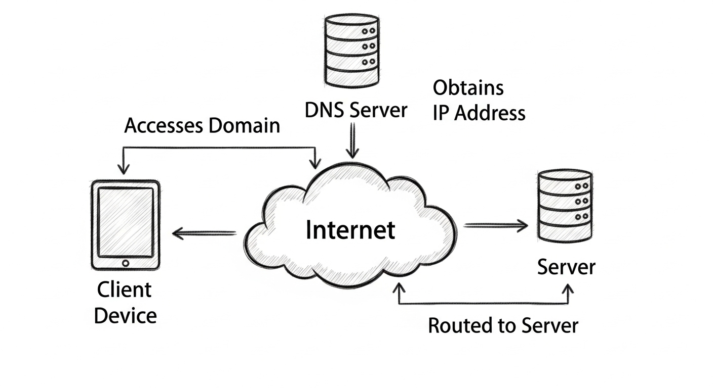
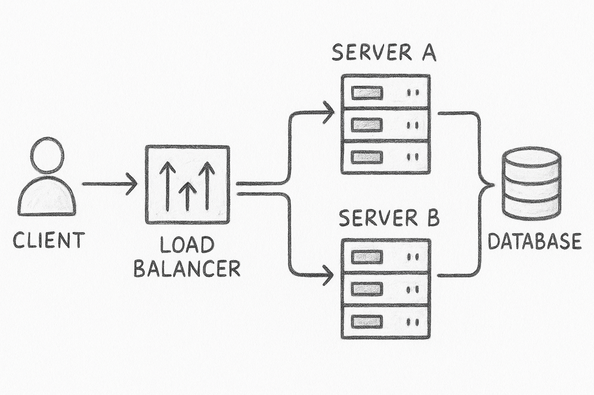
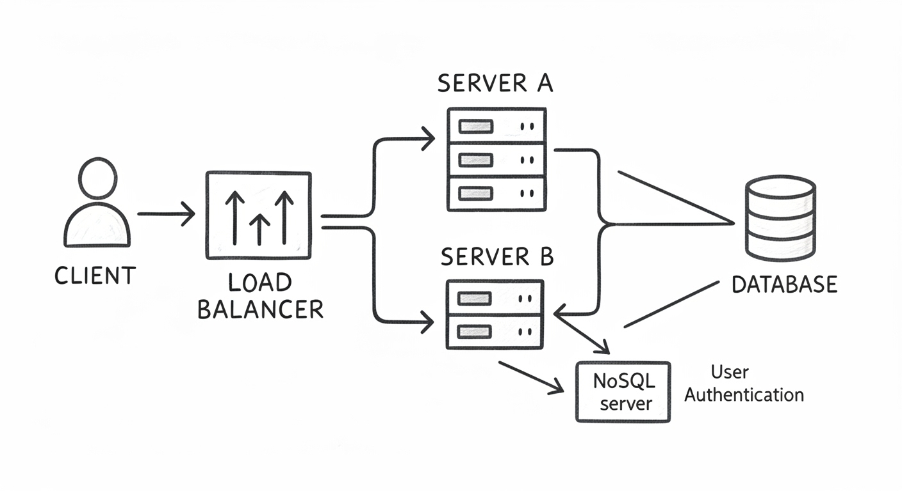
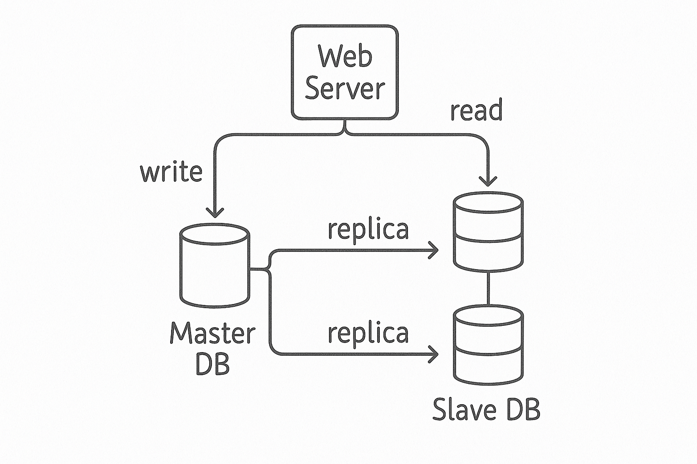
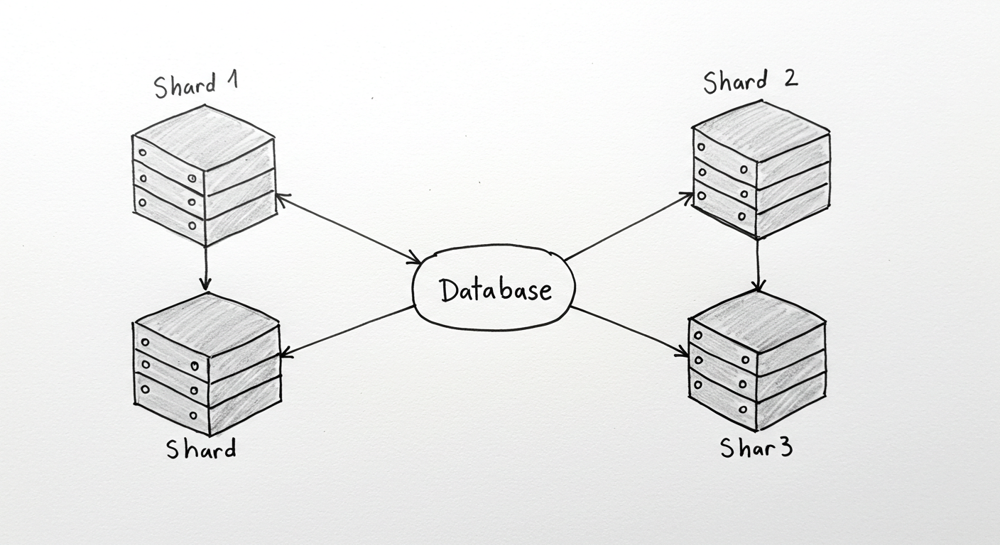
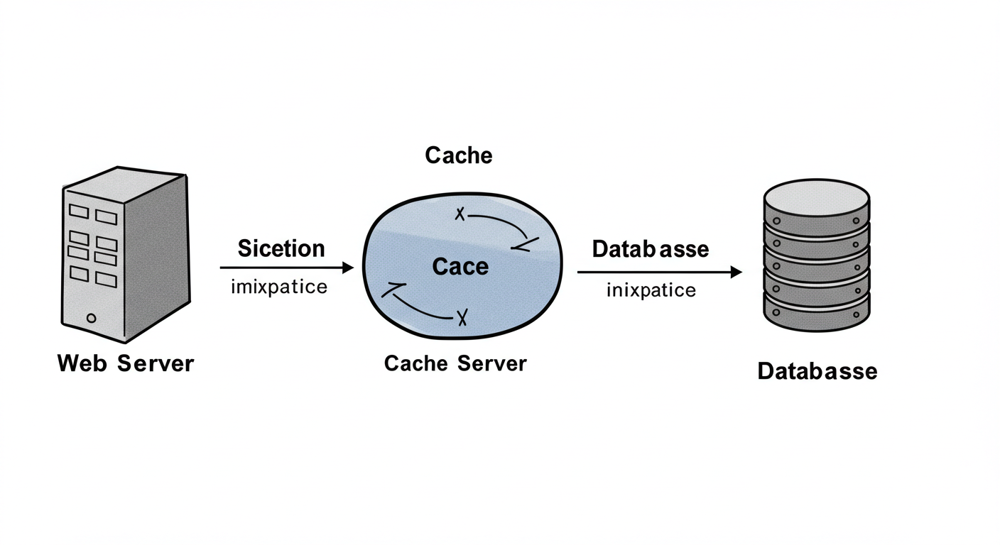
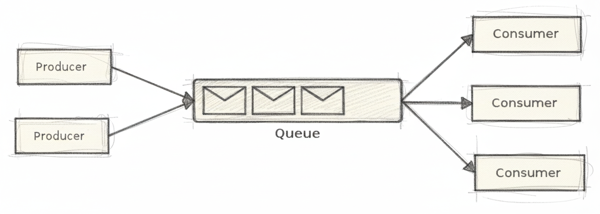
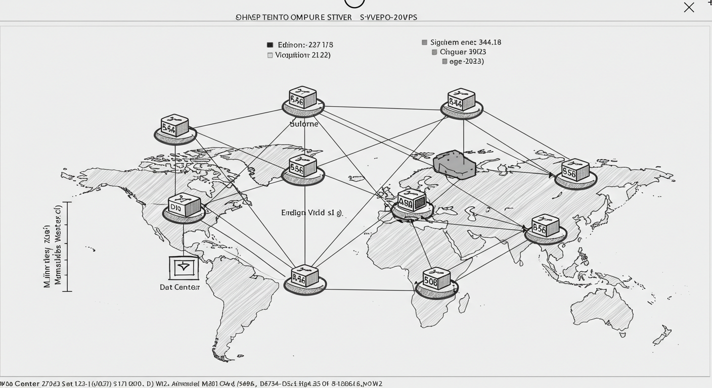

## 여는 말

항해 플러스를 하면서 코치님이 추천해주셨던 책 “가상 면접 사례로 배우는 대규모 시스템 설계 기초”를 드디어 다 읽었다. 엄청 어렵거나 두꺼운 책은 아니지만, 한동안 책장에만 있다가 최근에 꺼내서 점심에 야금야금 읽기 시작했다. 핵심 역량으로 시스템 설계를 내세우는 사람으로서 더 큰 규모의 프로젝트에서는 어떻게 설계해야할지 성장하고 싶은 마음이 있었다.

결과적으로 말하자면 부끄러울 정도로 나는 주먹구구로 만들어왔고, 이미 많은 고민과 연구로 다져진 좋은 설계안들이 있었다. 아는만큼 보인다고 역시 공부를 해야한다…

책을 읽으면서 내용을 정리하고 다시 공부하고 싶었던 파트를 시리즈처럼 기록해보려고 한다. 책에는 유튜브 설계, 뉴스피드 시스템 설계 등 재밌는 토픽들이 많지만 1장의 내용이 규모 확장에 따른 설계의 기초를 잘 담고 있는 것 같아서, 1장부터 차근차근 시작해보려 한다.

## 단일서버 & DB 분리

### 일단은 하나의 서버부터

가능한 가장 작은 시작은 모든 컴포넌트 즉 웹 앱, 데이터베이스, 캐시 등을 전부 한 대의 서버에서 시작한다. 사이드 프로젝트나 완전 초기의 비즈니스라면 이렇게 하나의 서버(인스턴스)에서도 문제없이 동작할 수 있을 것이다. 사용자는 도메인을 입력하면 DNS를 통해 서버의 IP를 조회하고 그 IP로 실제 요청을 전송하게 된다. DNS는 일반적으로 우리가 관여할 부분은 아니지만 조회된 IP에서부터의 요청은 우리가 설계한 범위안에 해당한다.

웹 어플리케이션은 비즈니스 로직, 데이터 입출력을 처리하고 HTML, JS 를 응답하는 웹 서버가 될 수 도 JSON을 응답하는 API 서버가 될 수도 있다.

### DB 분리

서비스에서 DB는 항상 가장 중요한 컴포넌트가 되는 것 같은데, 아무래도 서비스의 핵심적인 데이터들을 주로 가지고 있기 때문에 많은 부하로 인해서 서버가 꺼진다던가 데이터가 날아간다던가 하는 문제가 발생하면 안되기 때문인 것 같다. 그래서 운영 환경에서는 웹 앱 서버와 DB 서버를 분리하고 시작하는 걸 추천하는 것 같다. 웹 앱 서버는 개발자의 실수나 다양한 원인에 의해 서버 전체가 장애로 이어질 수 있는 잠재적 요소가 있기 때문이다.

웹 앱 서버와 DB를 분리하고나면 각각을 독립적으로 확장해나갈 수 있어진다. DB의 부하가 높다면 DB의 인스턴스 사이즈만 변경해주면 되기 때문에, 불필요한 비용 지출을 막을 수 있다.

- 어떤 Database를 선택해야할까?

  크게 2가지로 나눈다면 관계형(RDBMS)와 비관계형 (NoSQL)에서 고를 수 있다.

  MySQL, PostgreSQL, 오라클 등 행과 열로로 구성되어 있고 각 테이블간의 관계를 통해 Join 하여 합쳐서 데이터를 관리할 수 있다. 오랜기간 선택받아오면서 왠만한 서비스는 RDBMS로 구현이 가능하다고 생각한다.

  하지만 다루는 데이터가 비정형(구조가 자주 바뀐다?)이거나 아주 많은 양의 데이터를 저장한다거나 또는 아주 낮은 응답시간을 요구한다 등 특수한 목적에 의해서 NoSQL이 필요한 순간들이 있다. key-value, 그래프, 컬럼, 문서 등 다양한 형태로 저장할 수 있고, 목적에 맞게 선택하는게 중요하다.

## 규모확장 : 수직적 vs 수평적 → 로드밸런서

앞으로 규모를 확장해나가기 위해 알아둬야할 2가지 방법이 있다. 둘 중 뭐가 정답이다 라기보다는 상황에 더 맞는 선택을 하는게 중요할 것 같다.

- 수직적 규모 확장 (Scale up, Vetical Scaling)은 더 고성능 서버로 변경하는 것을 의미한다. 가장 단순한 방법이면서, 트래픽 양이 적을 때는 좋은 선택지가 된다. 하지만 CPU와 메모리는 무한대로 추가할 수 없고, 장애가 발생하면 서비스 전체가 완전히 중단되어버리는 문제가 있다.

- 수평적 규모 확장 (Scale out)은 동일한 서버를 여러대로 추가해 성능을 개선하는 것을 말한다. 위의 수직적 규모 확장의 단점 때문에 대규모 어플리케이션에 더 적합한 선택지이다. 하지만 서버가 분산되면서 생기는 이슈와 분산 환경을 고려해 개발할 사항들이 생긴다. 각 이슈를 해결하는 방법은 뒤에 설명하도록 하겠다.
  
  위의 수평적 규모 확장을 적용하기 위해 웹 서버를 2대 이상으로 늘리면 사용자 요청을 분산시켜줄 로드밸런서가 필요하다. 로드밸런서를 사용하면 클라이언트의 접속를 웹서버 대신 요청받고 내부에 연결된 웹서버들로 나눠주게 된다. 웹서버는 사용자의 요청을 직접 받을 필요가 없어졌기 때문에 내부용 Private IP를 사용하면서 허용되지 않은 외부 접속을 차단할 수 있고, 같은 VPC(사설 네트워크)안의 서버끼리 더 빠른 통신이 가능해진다.

이렇게 요청이 분산되기 때문에, 특정 서버가 다운되면 다른 서버가 대신 요청을 받아주면서 서비스를 장애 없이 유지할 수 있다. 또한 전체 트래픽이 늘어나면 동일한 서버만 추가해주면 되니까 확장성이 좋아진다.

### 무상태 웹 계층 → 공유 저장소

웹 서버를 수평적 규모 확장을 하면 생길 수 있는 문제가 뭐가 있을까. 가장 대표적인건 접속한 유저의 Session 정보 같이 각 서버가 가지고 있던 상태 정보일 것이다. 이 문제를 해결하기 위해서는 상태 정보를 별도로 보관할 수 있는 서버(RDBSM나 NoSQL 같은 DB 서버)가 필요하다. JWT 같이 상태를 저장하지 않는 인증방식을 쓰는 것도 방법일 것 같다.

상태 정보를 분리하지 않으면 어떤 문제가 생길까? 만약 유저A가 서버1을 통해서 로그인을 했고 그 상태 정보를 서버1이 보관하고 있다고 해보자. 문제는 로드밸런서가 요청을 여러 서버와 나눠서 받도록 해주고 있기 때문에 로그인 이후에 접속이 서버1이 아닌 서버2로 요청될 수 있다. 그러면 서버2는 유저A의 인증 정보를 가지고 있지 않기 때문에 인증이 만료되었다거나 하는 응답을 할 것이다. 로드밸런서가 고정 세션이라는 기능을 통해 유저A의 요청을 서버1로 고정해줄 수 있지만, 로드밸런서에 부하가 증가하고 서버 증설과 장애 처리의 복잡성이 증가한다.

공유 저장소를 추가해서 다수의 웹서버가 인증 정보를 저장하고 검증하도록 한다. 이제 유저A는 서버에 상관없이 항상 인증 상태를 유지할 수 있을 것이다. RDBMS를 사용할 수도 있지만 읽고 쓰기가 많고 Column 확장에 어려움이 있어서 Redis 같은 캐시 시스템이나 NoSQL을 주로 선택하는 것 같다.

## DB 다중화

이제 웹서버는 확장 가능한 형태로 변경했다. 그러면 DB는 어떻게 해야할까? 웹서버 수가 늘어나면 DB는 더 많은 connection을 유지하고 많은 트래픽이 발생하기 때문에 마찬가지로 다중화의 필요성이 있다.

많은 DBMS가 master-slave와 같은 다중화 방식을 제공하는데, 데이터의 원본은 master에 저장하고 slave가 그 사본을 저장하는 방식으로 동작한다. 원본은 master에 있기 때문에 쓰기 작업만을 담당하고, 읽기 작업은 slave를 통해서 실행한다. 대부분의 애플리케이션은 쓰기 작업보다 읽기 작업이 많기 때문에 slave 서버를 더 많이 두면서 읽기 작업의 부하를 분산한다. 이렇게되면 병렬로 처리될 수 있는 query의 수가 늘어나 성능이 좋아진다. 또한 서버가 여러대로 나눠어져 있기 때문에 장애가 발생해도 다른 서버에서 데이터를 가져올 수 있어진다.

slave 서버가 한 대 뿐인데 장애가 발생하면 master 서버가 읽기 연산까지 담당해준다. 그런데 만약 master 서버에 장애가 발생하면 어떻게 될까? slave 서버가 한 대 뿐인 경우엔 slave가 master가 되고 그 역할을 대신하게 된다. 하지만 프로덕션 환경에서는 더 복잡한 경우가 많은데, 부 서버에 보관된 데이터가 최신이 아닌 경우가 발생할 수 있다. 그럴 때는 복구 스크립트를 추가해야 하는데, 다중 마스터나 원형 다중화 같은 방식이 도움이 될 수 있다.

- 다중 마스터 vs 원형 다중화
  - 다중 마스터 : 모든 DB가 읽기, 쓰기 연산을 수행하고 변경사항을 서로 전파하는 방식
    - 데이터 병합시 충돌을 해결할 수 있는 충돌 해결규칙이 필요하다.
  - 원형 다중화 : 이웃한 노드와 주기적으로 복제하면서 데이터를 유지
    - 서로 데이터를 복제하는 노드간에 동시에 수정이 발생하는 경우 문제가 생길 수 있다.

### 수평 확장 : 샤딩

서비스가 커져서 저장할 데이터가 많아지면 DB의 부하가 증가한다. 데이터베이스도 규모 확장을 해야하는데, AWS의 24TB RAM의 RDS도 제공을 하지만 이런 수직적 확장에는 한계점이 있다. 웹서버와 마찬가지로 무한대로 CPU와 RAM을 늘릴 수 없고, SPOF의 위험성 증가와 비용 증가가 커진다. master-slave도 서로가 복제를 하기 때문에 전체 데이터가 많아지면 한계가 존재할 수 밖에 없다.

데이터베이스에서 수평적 확장은 샤딩이라고 부른다. 여러 서버가 **샤드**라는 단위로 데이터를 분할해 서로 중복되지 않도록 보관을 하는 것이다. 예를들어 서버가 4대이면 `user_id % 4` 를 해시 함수로 사용해 보관될 샤드를 정하는 것이다. 이렇게 분산될 기준인 키를 **샤딩 키**라고 부르고 가장 중요한 고려사항이 된다.

모든 해결책이 그렇듯 샤딩에도 새로운 문제가 발생한다.

- 샤드 소진 : 데이터가 너무 많아져서 샤드가 감당하기 어려워지거나 데이터 분포가 균등하지 못해 발생한다.
  - 샤드 키를 계산하는 함수를 변경하고 데이터를 재배치 해야한다.
  - [안정 해시 기법](https://ko.m.wikipedia.org/wiki/%EC%9D%BC%EA%B4%80%EB%90%9C_%ED%95%B4%EC%8B%B1)을 활용해 이 문제를 해결할 수 있다.
- 유명인사 문제 : 핫스팟 키 문제라고도 부르는데, 특정 샤드에 질의가 집중되면서 부하가 발생한다. 저스틴 비버 문제 라고도 부르던데, 이런 유명인사별로 샤드를 분리하거나 더 잘게 쪼개는 방식이 될 수 도 있다.
- 조인과 비정규화 : 데이터가 여러 샤드로 분리되면서 JOIN 명령이 어려워진다. 이걸 해결하기 위한 방법으로는 비정규화를 통해서 하나의 테이블에서 조회할 수 있도록 변경하는 것이다.

## 캐시

앞선 내용을 보아서 애플리케이션의 성능은 DB를 얼마나 자주 호출하느냐가 중요한 문제가 된다. 하나의 웹페이지를 렌더링하기 위해서도 여러 테이블을 조회하는 걸 종종 볼 수 있을 것이다. DB의 부하를 줄이고 응답속도를 높히기 위해 캐시을 고려할 수 있다.

그럼 어떤 데이터를 캐시에 넣어야할까? 대체로 값비싼 연산 결과(복잡한 SELECT 결과)나 읽기가 자주 일어나는 데이터를 담아둬 더 빠르게 처리할 수 있도록 한다.

웹서버가 캐시 계층을 이용하는 방법은 다음과 같다.

1. 웹서버가 요청을 받으면 캐시에 저장된 응답이 있는지 확인한다.
2. 만약 저장되어있다면 해당 응답을 그대로 반환한다.
3. 저장되어있지 않다면 DB에서 데이터를 조회해서 캐시에 저장하고 응답한다.

이런 읽기 주도형 캐시 전략 외에도 다양한 전략이 있기 때문에, 각 상황에 맞게 선택할 필요가 있다.

언듯보기엔 무조건적으로 좋아보이지만 사용하기에 유의할 점들이 있다.

- 업데이트가 자주 일어나지 않고, 자주 읽히는 데이터에 더 적합하다.
- 메모리 공간에 데이터를 저장하기 때문에 휘발되어도 괜찮은 데이터를 저장할 필요가 있다.
- 캐시의 만료기간이 너무 짧으면 DB 조회가 자주 일어나고 너무 길면 업데이트된 내용을 받아보는데 시간이 걸린다. 데이터의 신선도에 유의하자
- 원본이 갱신될 때 단일 트랜잭션으로 캐시를 갱신하지 않으면 데이터의 일관성이 깨질 수 있다.
- 캐시도 하나만 존재하면 SPOF가 될 가능성이 있기 때문에 확장을 고려해야한다.
- 캐시 메모리를 너무 작게 잡으면 캐시 데이터가 갑자기 늘었을 때 성능이 떨어질 수 있다. 캐시 메모리를 과할당해 해결할 수도 있겠다.
- 캐시 방출 정책을 고려해야한다. 캐시가 다 차면 기존 데이터를 삭제해야하는데, 마지막으로 사용된 시점이 가장 오래된 데이터(LRU)를 내보낼 수 있다. 이 외에도 LFU(사용빈도가 낮은 것), FIFO(먼저 들어온 것)등 다양한 정책이 있고, 상황에 맞게 적용이 가능하다.

## 메시지 큐

시스템을 더 큰 규모로 확장해나가면서 서비스의 컴포넌트를 분리하여, 각자 독립적으로 확장될 수 있도록 해야한다. 메시지 큐는 많은 분산 시스템(MSA 등)이 채용하고 있는 핵심적인 전략 중 하나이다. 메시지 큐를 사용하면 서비스 간 결합이 느슨해지면서 안정적으로 규모 확장성을 보장할 수 있다.

메시지 큐는 발행자가 메시지를 만들어 발행하고, 구독자가 그 메시지를 받아 동작을 수행한다. 이 과정에서 메시지 큐는 메시지가 소비될 때까지 안전하게 보관하는 것을 보장하는 특성을 가진다.

이미지 처리처럼 시간이 오래 걸리는 작업등을 분리해 비동기적으로 처리하도록 할 수 있다. 구독자 서비스가 분리됨으로서 큐에 작업량에 따라 유동적으로 규모를 변경해나갈 수 있다.

## 로그, 메트릭, 자동화

서비스가 커지면 시스템 전체를 모니터링하고 자동으로 처리될 수 있는 것을 늘려야 개발 생산성을 크게 향상시킬 수 있다.

- 로그 : 단일 서비스로 로그를 모아서 시스템의 오류와 문제들을 빠르게 찾을 수 있도록 해준다.
- 메트릭 : 서버 CPU, 메모리, 디스크 I/O와 같은 호스트 단위 메트릭과 일별 능동 사용자, 수익, 재방문 등 핵심 비즈니스 메트릭을 포함한다.
- 자동화 : CI/CD 같이 검증 절차와 배포 절차 자동화를 통해 배포까지의 인적 작업을 줄일 수 있다.

## CDN

이미지, 비디오, CSS 등 정적 콘텐츠를 지리적으로 분산해 응답하는 서버의 네트워크다. 내가 만약 한국에서 미국 서버에 있는 이미지를 보려면 바다를 건너 오느라 오랜 시간이 걸릴 것이다. 이럴 때 내 지역에서 가까운 리전에 저장된 데이터를 미국 대신 응답해 빠르게 받아볼 수 있게 하는 것이다.

- CDN도 캐시기 때문에 만료기간이 길면 신선도가 떨어질 수 있다.
- CDN에 장애가 발생하면 원본 서버에서 직접 콘텐츠를 가져온다던가 하는 클라이언트 구성이 필요할 수 있다.

캐시와 마찬가지로 이번엔 웹서버의 정적 콘텐츠 서빙을 대신해주면서 웹서버의 부하를 줄일 수 있다.

## 데이터 센터

서비스가 점점 더 글로벌화 되면서 아예 다른 리전에 서버를 운영해서 응답 속도를 빠르게 할 필요가 있다. 그럴 떄 복수의 데이터 센터를 이용하고 지리적 라우팅을 통해 요청을 안내한다. Route53의 경우 A 레코드를 지정할 때 이런 지리적 라우팅 옵션을 선택할 수 있다.

로드밸런서가 데이터 센터의 라우팅을 담당하면서 만약 하나의 데이터 센터에 장애가 발생하면 모든 트래픽은 장애가 없는 데이터 센터로 전송된다.

- 데이터 센터마다 별도의 DB를 운영한다면 데이터 동기화 문제를 고려해야한다. 보편적으로 데이터를 여러 데이터 센터에 다중화해서 해결할 수 있다.
- 자동 배포를 통해 여러 위치에서 테스트와 배포를 진행할 필요가 있다.

## 마무리

시스템의 규모를 확장하는 것은 지속적이고 반복적인 과정이라고 한다. 이번에 소개한 확장 방식들을 하나씩 적용하면서 규모가 커지고, 앞으로 소개한 대부분의 아키텍처에서도 동일한 확장법을 사용하게 된다. 대부분의 기술이 그렇듯 문제를 해결하기 위해 새로운 전략을 도입하면 그 전략에 의해 발생하는 문제들이나 유의할 점들이 생겨난다.

앞으로 4~5개 정도의 아키텍처를 더 소개할 생각인데, 책에 있는 내용과 추가로 조사한 내용을 조합해 작성하느라 시간이 꽤나 걸리는 작업이다. 그렇지만 글로 다시 쓰면서 내 것이 되어가는게 느껴지는 작업이라 설레고 기대가 된다.
